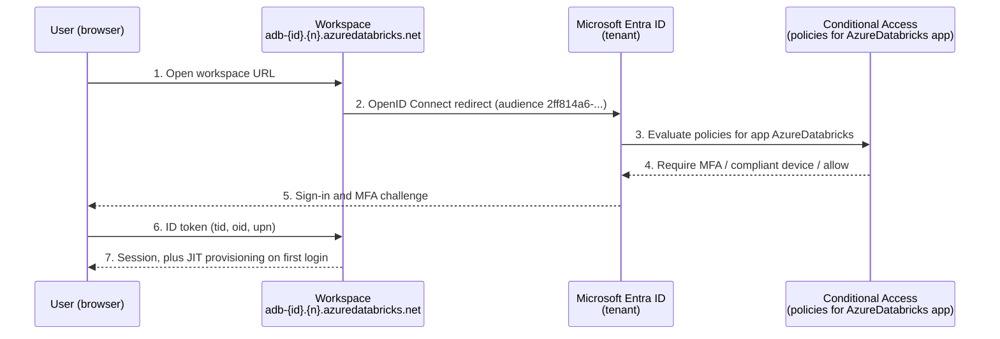
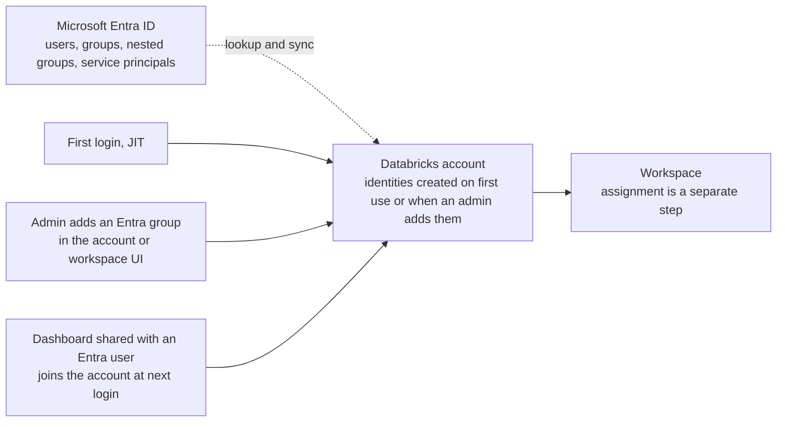

# S2: Azure Databricks Cloud Integrations

Course: [Azure Databricks Platform Architect](https://customer-academy.databricks.com/learn/courses/7541/azure-databricks-platform-architect) (Databricks Academy)

Overlap with S1: tenant binding, the first account admin, and the account console Security page are in [S1 1.4 Account Administration on Azure](S1-workspace-administration.md#14-account-administration-on-azure). The Entra application ID first came up in [S1 1.1](S1-workspace-administration.md#11-azure-databricks-service-architecture). The notes below cover what this section adds.

---

## 2.1 Microsoft Entra ID Native Integration

Lecture, 10 min. Theme: *identity you don't have to wire.*

Objectives: explain why Azure Databricks needs no SSO configuration; apply Conditional Access and tenant MFA implications.

### A. No SSO to configure ⚠️

- On **AWS and Google Cloud**, an admin sets up SSO in the account console. On **Azure there's nothing to configure.**
- **Entra ID login is on by default** for the account console and every workspace, over **OpenID Connect**. The account is bound to your tenant.
- The account console still has a **Security → Identity provider setup** tab. On Azure, the work there is **identity management and federation policies**, not choosing a sign-in method.

**A browser login to a workspace** (lesson diagram):

**The details that matter:**

| Item | Fact |
|---|---|
| **The application** | Enterprise app **`AzureDatabricks`** in every tenant, fixed app ID **`2ff814a6-3304-4ab8-85cb-cd0e6f879c1d`** |
| What that app ID is used for | **Audience of Entra ID access tokens** issued for Azure Databricks, **target of Conditional Access policies**, and the principal you grant **Key Vault Crypto Service Encryption User** (or an access policy with get, wrapKey, unwrapKey) for **customer-managed keys** |
| **Tenant binding** | Account tied to the tenant ID. Moving a workspace to another tenant is **unsupported**: it stays in the original account. Several tenants → the account console opens your **default** tenant's account; reach another tenant's account from a workspace in that tenant. |
| **Users** | A workspace admin can add **any user in the workspace's Entra tenant, B2B guests included**. Automatic identity management uses the **guest's email as the username**. **Identity federation is on for every new workspace and can't be turned off.** |
| **Token claims checked** | **`aud`** = the app ID, **`iss`** = `https://sts.windows.net/{tenant-id}/`, **`tid`** = the workspace's tenant |

> Exam angles:
> - "Configure SSO for Azure Databricks" → nothing to configure. Entra ID over OIDC is native.
> - "Which object do you target with Conditional Access / grant Key Vault access for CMK?" → the **AzureDatabricks** enterprise app, ID `2ff814a6-...`.
> - "Entra ID token rejected" → check `aud`, `iss`, `tid` against the app ID and the workspace's tenant. (Databricks OAuth tokens and federated tokens use other audiences; see Course vs docs.)

### B. Conditional Access and MFA inherit from the tenant ⚠️

| Where policy lives | What you can require | Side effects to expect |
|---|---|---|
| **Entra admin center → Entra ID → Conditional Access → New policy**. Target resource: search the app ID or the name **AzureDatabricks**. | **MFA**, **compliant or hybrid-joined devices**, **named locations**, **sign-in risk** levels | A CA policy on **Azure DevOps** plus one on Azure Databricks can **break Git folder clones** with a denied-access error. Fix: exclude Azure Databricks IPs or the affected users. |
| Needs **Entra ID P1**. Risk-based policies need **ID Protection (a P2 feature)**. Role to create them: **Conditional Access Administrator**. | **Session controls** such as **sign-in frequency** | **Service principals** are governed by **Conditional Access for workload identities**, a separately licensed feature (**Microsoft Entra Workload ID Premium**). |
| The Azure security baseline lists CA for the data plane as **supported and enabled by default**. | Policies run **whenever Entra issues the token**: browser logins **and** Entra token flows like the **Azure CLI**. A **Databricks OAuth secret never passes through Entra**, so **no CA policy touches it**. | **Blocked sign-ins never reach Databricks.** The evidence is in the **Entra sign-in logs**, not the Databricks audit table. |

> Exam angles:
> - "User blocked at login, nothing in `system.access.audit`. Where do you look?" → **Entra sign-in logs**.
> - "Require MFA for a service principal" → **not possible**: service principals can't do MFA. CA for **workload identities** (Workload ID Premium) can only **block** access, based on location or risk. And a **Databricks OAuth secret** (M2M) bypasses Entra entirely, so CA never sees it.
> - "Git folder clone suddenly fails with access denied" → CA on Azure DevOps interacting with Databricks. Exclude Databricks IPs or the users.
> - "Licensing for risk-based CA" → P2 (ID Protection). Basic CA → P1.

### C. Guests and cross-tenant scenarios ⚠️

| Scenario | What works |
|---|---|
| Partner user from another tenant | Invite them as a **B2B guest in the workspace's home tenant**, then add them. AIM uses the guest's **email** as the username. |
| Users spread across several tenants | AIM reads the **home tenant only**, including matching B2B guest objects there. It **doesn't read another tenant's directory**. Check guest identity matching and the **migration readiness report**. |
| Publishing to Power BI as a guest | **Not supported.** Users publish only to Power BI workspaces in their **home** tenant. |
| Workspace moved to a new tenant | **Unsupported.** The workspace stays in the original account. Plan a **new workspace and migrate**. |

### D. What stays configurable on the Databricks side

| Provisioning | Authentication controls | Perimeter |
|---|---|---|
| **Automatic identity management (AIM)** toggle and its **account access denylist (up to 100 rules)**, both under **Security → Identity provider setup → Identity management** | **Federation policies** for OAuth token federation: **account-wide** under Identity provider setup, **per service principal** under its **Credentials & secrets** tab | **IP access lists** for the account console and for workspaces, **1,000 entries each** |
| **Just-in-time (JIT) provisioning**: on by default for accounts created after **May 1, 2025**, and **always on when AIM is enabled** | **Token report** under Security: filter, export, and **revoke personal access tokens account-wide** | **Context-based ingress control** is the recommended primary control (**GA for workspace policies**, **Beta for the account-console policy**) |
| **SCIM** where you still need it (lesson 2.2) | Workspace toggles for **PATs and their maximum lifetime** (lesson 2.3) | **Private Link** and public network access (Section 3) |
| | | **No Databricks-side session timeout is documented.** Sign-in frequency is an **Entra Conditional Access session control**. |

**Don't carry AWS vocabulary over.** *Unified login* and *emergency access* are documented for AWS and Google Cloud accounts only. The Azure docs cover neither, even though the generic description of the Identity provider setup tab lists a Unified login section. The Azure version of "emergency access" is a **break-glass Entra account excluded from Conditional Access** that holds **Contributor or Owner on the workspace resource**: that user gets **workspace admin** when they click **Launch Workspace** in the Azure portal (same rule as [S1 1.4](S1-workspace-administration.md#14-account-administration-on-azure)).

> Exam angles:
> - "Make users sign in again every 4 hours" → **Entra CA sign-in frequency**, not a Databricks setting. Note: sign-in frequency is a **periodic reauthentication interval**, not an inactivity timeout. It's enforced when the app next goes to Entra for a token, so it doesn't guarantee an idle session ends at the mark.
> - "Revoke every PAT a departed user created, across workspaces" → **account console Token report**.
> - "Stop AIM from bringing in certain users" → the AIM **account access denylist** (max 100 rules).
> - "Emergency access if CA locks everyone out" → break-glass Entra account excluded from CA, with Contributor/Owner on the workspace.

### Key takeaways

- Entra ID login is native: OIDC against the **AzureDatabricks** app (`2ff814a6-3304-4ab8-85cb-cd0e6f879c1d`). No identity provider to configure in the account console.
- Conditional Access and MFA are **tenant policies** (Entra ID P1) targeting that app. Blocked sign-ins show only in **Entra** logs.
- AIM supports matching B2B guest objects in the **home tenant**. It can't read another tenant's directory.
- Workspaces can't move between tenants.
- Databricks-side controls: AIM and JIT, federation policies, token report, IP access lists, context-based ingress. **Periodic reauthentication (sign-in frequency) belongs to Entra.**

### Course vs docs

- **Two dates, two features. Don't mix them up.** This lesson: **JIT provisioning** is on by default for accounts created after **May 1, 2025**. [S1 1.4](S1-workspace-administration.md#14-account-administration-on-azure): **AIM** is on for accounts created after **August 1, 2025**. Not a conflict, but an easy swap on a quiz.
- "No Databricks-side session timeout is documented" is the course's wording for Azure. The Entra answer is sign-in frequency, which forces **periodic reauthentication**. It isn't an idle timeout ([session lifetime docs](https://learn.microsoft.com/en-us/entra/identity/conditional-access/concept-session-lifetime)). Recheck the Databricks side before relying on it, since workspace settings change often.
- **Token audience.** The lesson says the app ID is the audience of *every* token. That's true for **Entra ID access tokens**, but [OAuth federation policies](https://learn.microsoft.com/en-us/azure/databricks/dev-tools/auth/oauth-federation-policy) accept the audiences you configure (default: the Databricks account ID), and Databricks-issued OAuth tokens don't come from Entra at all.
- **Service principals and MFA.** Service principals can't do MFA. [CA for workload identities](https://learn.microsoft.com/en-us/entra/identity/conditional-access/workload-identity) supports only the **Block** grant control.
- Things likely to change: context-based ingress for the account console (Beta), and the AIM denylist limit (100 rules).
- No conflicts found with S1 or DP-750 notes.

### Official references (from the lesson, checked 2026-10-27)

- [Authentication and access control](https://learn.microsoft.com/en-us/azure/databricks/security/auth/)
- [Manage users](https://learn.microsoft.com/en-us/azure/databricks/admin/users-groups/users)
- [Get Entra ID tokens manually](https://learn.microsoft.com/en-us/azure/databricks/dev-tools/auth/aad-token-manual)
- [API access permissions](https://learn.microsoft.com/en-us/azure/databricks/security/auth/api-access-permissions)
- [Workload identities FAQ](https://learn.microsoft.com/en-us/entra/workload-id/workload-identities-faqs)
- [Automatic identity management](https://learn.microsoft.com/en-us/azure/databricks/admin/users-groups/automatic-identity-management/)
- [Migrate to AIM](https://learn.microsoft.com/en-us/azure/databricks/admin/users-groups/automatic-identity-management/migrate-to-aim)
- [SCIM provisioning with Entra ID](https://learn.microsoft.com/en-us/azure/databricks/admin/users-groups/scim/aad)

### ⚡ Quick review

- [ ] Why is there no SSO to configure on Azure? What protocol does the login use?
- [ ] What's the AzureDatabricks app ID, and what 3 things is it used for?
- [ ] Which 3 token claims does a workspace check, and what must each equal?
- [ ] What Entra license does Conditional Access need? Risk-based policies?
- [ ] How do you put Conditional Access on a service principal? Does CA apply to a Databricks OAuth secret?
- [ ] A user is blocked at sign-in. Where's the evidence?
- [ ] Why might Git folder clones break, and how do you fix it?
- [ ] How do you bring in a partner from another tenant? Can AIM read their home tenant?
- [ ] Can a B2B guest publish to Power BI in your tenant?
- [ ] Where do you force periodic reauthentication? Is that the same as an idle timeout?
- [ ] JIT default date vs AIM default date
- [ ] What's the Azure equivalent of AWS "emergency access"?

---

## 2.2 Automatic Identity Management

Lecture, 12 min. Theme: *identities that arrive on their own.*

Objectives: operate AIM as the default provisioning path; migrate from SCIM and manage coexistence.

### A. AIM is the default ⚠️

- **Automatic identity management (AIM)** lets Azure Databricks read **users, groups, nested groups, and service principals** straight from your Entra tenant. **No enterprise application, no SCIM token, no Entra admin role.**
- **GA on September 10, 2025.** **On by default for accounts created after August 1, 2025** (matches [S1 1.4](S1-workspace-administration.md#14-account-administration-on-azure)).
- Older accounts turn it on in the **account console → Security → Identity provider setup → Identity management**. The change takes **5 to 10 minutes**.
- Needs: **Premium tier**, a **single Entra tenant**, and **at least one identity-federated workspace**.

**How identities arrive** (lesson diagram):

**AIM vs SCIM:**

| Capability | Automatic identity management | SCIM provisioning |
|---|---|---|
| Users | Yes: on first login, when an admin adds them, or when a dashboard is shared with them | Yes, pushed by the Entra app |
| **Groups** | Yes, **including nested groups** (transitive membership) | **Direct members only, no nesting** |
| **Service principals** | Yes, **on first use** | **Not supported** by the Entra gallery app |
| **Entra prerequisites** | **None**: any Entra edition, no admin role | **Cloud Application Administrator**; **Entra Premium** to provision groups |
| Workspaces | Requires **identity federation** (on for every new workspace) | Account-level or legacy workspace-level connectors |
| Directory scope | **Home tenant**, including matching B2B guest objects | B2B provisioning depends on the connector; inspect identity matching |

> Exam angles:
> - "Need nested Entra groups / service principals in Databricks without granting an Entra admin role" → **AIM**.
> - "Customer on Entra Free, wants groups provisioned" → AIM (SCIM groups need Entra Premium).

### B. Provisioning behavior and sync cadence ⚠️

| Just-in-time | Group membership refresh | Things that surprise people |
|---|---|---|
| **JIT is always on when AIM is on, and can't be disabled** | **Browser login**: memberships sync if **more than 5 minutes** have passed since the last sync | Synced groups are **account-level**. **Assigning them to a workspace is a manual step**, and a **child group must be assigned itself** before it can hold workspace-object permissions. |
| Users are created at first login, when an admin adds them, or when a dashboard is shared with them. They join the **account** at login, **not the workspace**. | **Tokens and jobs**: under 10 min since last sync → no refresh. **10 to 40 min** → asynchronous refresh. **Over 40 min** → refresh **before the request completes**. | **A group rename isn't pushed**: it syncs when an account admin **opens the group's detail page** |
| **Service principals** are created on **first use** (token auth or job run), **not when their group is added** | **SCIM** syncs on its own cycle, **every 20 to 40 minutes** | **An email change creates a new user** instead of updating the old one |
| | | **Users deleted in Entra are deactivated on the next sync. Their tokens are not revoked.** |

**Identity attributes (Beta).** AIM can sync a fixed set of **nine Entra user attributes** onto account users: `title`, `userType`, `locality`, `region`, `country`, `costCenter`, `organization`, `division`, `department`.
- Purpose: **Unity Catalog ABAC** policies can use them, for example to mask a column unless the user's `country` matches the data.
- An account admin turns on the **Identity Attribute Control List** preview (account console → Previews). The control list is an **account-level allowlist** of which of the nine attributes may be written. Every AIM sync reconciles stored values against it.
- **Users only**, one value each, **read-only** in the console (User management → user → Identity attributes tab).
- Entra has **no native source for `costCenter` or `division`**, so those need a **custom extension attribute**.
- Refresh: the signed-in user within about **5 minutes**, everyone else within **5 days**.

**Evidence in the audit log.** Identities created by AIM carry `request_params.endpoint = 'autoUserCreation'`, and group memberships carry `groupMembershipType = 'IdentityProvider'`, in `system.access.audit`. AIM-managed identities show as **External** in the UI and **can't be edited there**.

> Exam angles:
> - "Service principal's group was added but the SP isn't in Databricks" → SPs appear on **first use**, not when their group is added.
> - "Entra group synced, but it can't be granted on a workspace object" → **assign the group to the workspace** (and assign child groups on their own).
> - "User left, removed from Entra, but their PAT still works" → deactivation doesn't revoke tokens. **Revoke in the Token report** (2.1 D).
> - "User's email changed and they lost access" → AIM made a **new user**.
> - "Prove a user came from AIM" → `system.access.audit`, `request_params.endpoint = 'autoUserCreation'`.

### C. SCIM: still supported, no longer the default

SCIM uses the Entra gallery app **Azure Databricks SCIM Provisioning Connector** with a SCIM URL and token from the account console. Databricks recommends AIM, but SCIM still works.

| Where SCIM still wins | Where SCIM loses |
|---|---|
| Existing **B2B provisioning flows** that haven't passed AIM readiness checks | The gallery connector **doesn't provision nested groups or service principals**. Check its documented attribute mappings for updates. |
| Estates that depend on **`externalId` matching** or **locally modified group memberships** | Needs **Cloud Application Administrator** and **Entra Premium** for groups |
| Organizations that require an **Entra-side provisioning record** for every identity | **20 to 40 minute cycles**. The connector **isn't available in Azure China**. |

### D. Migrating and coexisting ⚠️

**Migration steps, in order:**
1. Run the **AIM readiness report**: external ID and group membership mismatches, and which workspaces are identity-federated.
2. Audit automations that reference service principals **by display name**. AIM overwrites display names from Entra, so reference the **application ID** instead.
3. Optionally configure the **account access denylist** to block specific users, groups, or SPs from being provisioned (contractors, test accounts). Then notify workspace admins.
4. **Enable AIM** under Security → Identity provider setup → Identity management. Wait 5 to 10 minutes.
5. **Validate** as an account admin (add a user and a group from Entra) and as a workspace admin (add a user, share an asset with a group).
6. Confirm in `system.access.audit` using the **`autoUserCreation`** endpoint.
7. **Disable SCIM only if** all three hold: **no nested groups are relied on**, **`externalId` values already match Entra object IDs**, and **no memberships were modified locally**. Otherwise **keep both running**.

**Coexistence rules:**
- **SCIM keeps managing the identities it created**, and AIM ignores those.
- **AIM never removes memberships that SCIM synced.**
- Use the readiness report to fix identity and membership mismatches **before** changing provisioning paths.
- **Turning AIM off later**: users and SPs stay, but **the groups AIM manages lose all their members**. So **set up SCIM first** so it can take over membership sync if you ever need to reverse.

> Exam angles:
> - "First step of a SCIM → AIM migration" → **run the readiness report**.
> - "Jobs broke after enabling AIM because a script looks up the SP by name" → AIM overwrote display names. Use the **application ID**.
> - "Can we switch off SCIM now?" → only if no nested groups are relied on, `externalId` matches Entra object IDs, and no local membership edits. Otherwise run both.
> - "Need to roll back AIM without breaking group permissions" → **stand up SCIM first**, then turn AIM off.

### Key takeaways

- AIM is GA (September 10, 2025) and the default for accounts created after August 1, 2025. Older accounts flip the switch under Security → Identity provider setup.
- It syncs users, groups, nested groups, and service principals with no Entra app and no admin role. JIT is always on. Identity attributes (Beta) add nine user attributes for UC ABAC.
- Browser logins refresh memberships after 5 minutes, tokens and jobs within 40 minutes. Groups still need workspace assignment.
- Keep existing SCIM until the migration conditions are met. The gallery connector doesn't provision nested groups or service principals.
- Migrate with the readiness report, validate through the audit table, and keep SCIM in parallel unless the three disable conditions hold.

### Course vs docs

- Consistent with 2.1: JIT is on by default for accounts created after May 1, 2025 (2.1), and **always on when AIM is enabled** (here). AIM's own default date is August 1, 2025.
- Things likely to change: identity attributes and the Identity Attribute Control List are **Beta/preview**, and UC ABAC column masking with them is documented as Beta. The 9-attribute list may grow.
- No conflicts found with S1 or 2.1.

### Official references (from the lesson, checked 2026-10-27)

- [Automatic identity management](https://learn.microsoft.com/en-us/azure/databricks/admin/users-groups/automatic-identity-management/)
- [Migrate to AIM](https://learn.microsoft.com/en-us/azure/databricks/admin/users-groups/automatic-identity-management/migrate-to-aim)
- [SCIM provisioning with Entra ID](https://learn.microsoft.com/en-us/azure/databricks/admin/users-groups/scim/aad)
- [Identity attributes](https://learn.microsoft.com/en-us/azure/databricks/admin/users-groups/identity-attributes/)
- [Account access denylist](https://learn.microsoft.com/en-us/azure/databricks/admin/users-groups/automatic-identity-management/account-access-denylist)

### ⚡ Quick review

- [ ] When did AIM go GA, and which accounts have it on by default? What does it need?
- [ ] Name 3 things AIM handles that the SCIM gallery connector doesn't.
- [ ] When is a service principal created under AIM?
- [ ] Group membership refresh: browser login vs tokens and jobs (the 5 / 10 / 40 minute rules)
- [ ] What happens on an Entra group rename? An email change? A user deleted in Entra?
- [ ] Why can't a synced child group hold workspace-object permissions yet?
- [ ] Which 9 attributes can identity attributes sync, and which 2 need a custom extension attribute?
- [ ] How do you prove an identity came from AIM?
- [ ] First migration step? Why reference SPs by application ID?
- [ ] The 3 conditions for turning SCIM off
- [ ] What breaks if you turn AIM off, and how do you prepare?

---

<!-- Next: 2.3 Service Principals, Managed Identities, and API Auth -->
